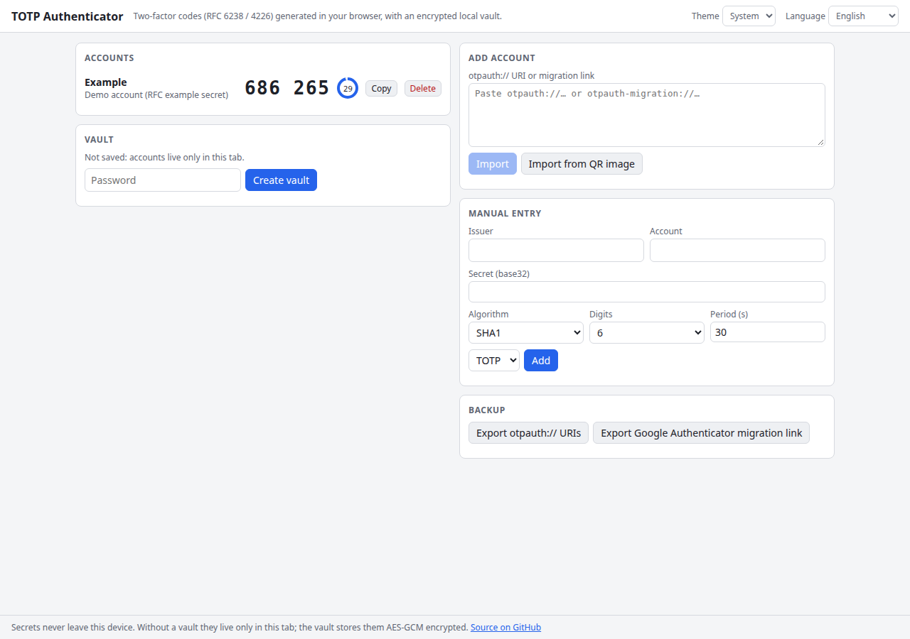

# TOTP Authenticator

TOTP/HOTP code generator (RFC 6238/4226) with otpauth:// parsing, QR import from image, Google Authenticator migration decode and an encrypted local vault.

**Try it: [hermes98761234.github.io/totp-authenticator](https://hermes98761234.github.io/totp-authenticator/)**

[](https://github.com/hermes98761234/totp-authenticator/actions/workflows/deploy.yml)



## Features

- **RFC 6238 TOTP and RFC 4226 HOTP** with SHA-1/256/512, 6-8 digits and custom periods, verified against the RFC test vectors.
- **Import** from `otpauth://` URIs, from a **QR code image** (jsQR) and from **Google Authenticator migration** links (`otpauth-migration://`, protobuf decoded in the browser).
- **Encrypted local vault**: PBKDF2-SHA256 (600k iterations) + AES-GCM in localStorage; lock and unlock.
- **Backup**: export `otpauth://` URIs or a Google Authenticator migration link.
- Live countdown ring, one-click copy, manual entry.
- English and Ukrainian, light/dark/system theme. No backend, no tracking: your data never leaves the browser.

## How it works

Codes are computed with WebCrypto HMAC. The migration payload is a small protobuf (OtpParameters: secret, name, issuer, algorithm, digits, type, counter) that is parsed by a hand-written reader. The vault key is derived from your password with PBKDF2; the account list is encrypted with AES-GCM and only the ciphertext is stored. Without a vault the accounts exist only in memory. If you forget the password the vault cannot be recovered.

## Quick start

You need [Node.js](https://nodejs.org/) 22.

```bash
git clone https://github.com/hermes98761234/totp-authenticator.git
cd totp-authenticator
npm install
npm run dev       # http://localhost:5173
npm test          # unit tests
npm run build     # static site in dist/
```

## License

MIT
